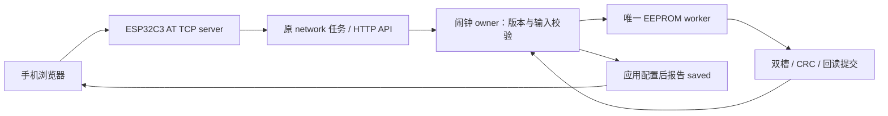

# 第二阶段：同一 WiFi 的手机闹钟管理

本阶段最初版本为 `v1.3-WEB`，当前 `v1.4-ONENET` 保留全部网页功能并增加云端控制，见 [ONENET_MQTT_TESTS.md](ONENET_MQTT_TESTS.md)。沿用已焊接开发板、ESP32C3 的原 AT 固件和第一阶段 EEPROM 格式。H1 保持用户已验证可用的现有状态，本阶段不要求改焊，也不修改按键、蜂鸣器或 AHT20 的引脚。

手机访问 ESP 的局域网 HTTP 地址，网页由 STM32 固件提供，无 App、云服务器、CDN 或额外电脑服务。可查看、设置、开关全部 8 组闹钟；网页与本地按键使用同一套运行配置和 EEPROM 保存流程。预览用电脑模拟接口不属于上板运行依赖。

## 烧录与访问

```powershell
.\scripts\build.ps1 -Configuration Release
```

烧录 `build/Release/Clock_CubeMX.hex`；BIN 起始地址 `0x08000000`。保留第一阶段已使用的 WiFi/南京天气配置 `app/clock_config_local.h`，无需在网页输入密码或天气密钥。默认仍为 PWM 蜂鸣器；实物若使用有源版本，继续加 `-ActiveBuzzer`。

USART1 打开 **115200、8N1**，确认版本及以下日志：

```text
[SYS] Clock_CubeMX v1.3-WEB ...
Alarm storage boot result ...
[WIFI] AT and SNTP initialized
[WEB] Open http://192.168.x.x/ on the same WiFi
```

地址由路由器分配，以本次串口打印值为准。手机与 ESP 连能互相访问的同一局域网，在浏览器地址栏输入完整 `http://192.168.x.x/`，打开“时钟 · 闹钟管理”。手机在 5 GHz、ESP 在 2.4 GHz 也可使用，前提是路由器把它们桥接在同一 LAN。访客网络、AP 隔离、手机 VPN/代理或不相通的 VLAN 可能阻止访问；本版本不提供跨公网访问。

正常应显示设备时间和 **8 张闹钟卡片**。没有有效 RTC 时显示“设备时间未校准”，仍可查看和保存配置，日历到点触发需先通过 SNTP 或本地按键校时。

## 网页操作

- **开关**：点击卡片右上角开关；网页先读取最新配置，再提交该组的开关状态。
- **设置**：点击“编辑”，设置时间、启用、重复星期、贪睡 1～30 分钟、响铃 5～600 秒。星期全不选时，出现指定日期，只响一次。
- **保存**：点“保存到时钟”；“正在提交”和“设备正在写入”都只是处理中。只有 EEPROM 提交及回读成功、运行配置应用后，才显示“已保存到时钟”。
- **刷新**：空闲页面每约 10 秒刷新；编辑时暂停自动刷新，保留草稿。弹窗里的“刷新设备并核对”可读取设备实际值而不丢失输入。
- **冲突**：另一部手机或本地按键先修改时，旧草稿不能直接覆盖。刷新核对后，可手动合并最新设置，只保留自己修改的字段；同一字段双方都改过时会显示草稿值与设备值，核对后再保存。
- **结果不确定**：请求发出后若掉线，配置可能已经保存。先“刷新设备并核对”，查看实际值，确认后再决定是否重试。页面不会自动重复提交。

本地正在编辑闹钟/校时时，手机暂时不能提交修改；本地仅停留在列表时可以。按键停止/贪睡和定时触发不等待手机或 EEPROM 保存。手机提交不会强制开发板切入菜单；本地列表会刷新对应配置。

## 上板测试顺序

| 测试 | 操作 | 应看到的结果 |
|---|---|---|
| 旧配置保留 | 烧录第二阶段固件后打开网页，对照本地列表 | 原 8 组配置保留，无需重新设置 |
| 手机开关 | 开启/关闭第 1、8 组，等待成功，再用按键查看 | 手机与板端状态一致；未修改的组保持原值 |
| 手机编辑 | 第 1 组设为今天、未来 2～3 分钟的一次闹钟，响铃 10 秒、贪睡 1 分钟 | 成功后到点响铃；K1 停止、K2 贪睡正常 |
| 八组独立 | 设置 8 组不同时间、星期和开关；第 1/8 组同一分钟 | 逐组一致，同分钟同时触发，无其他组被覆盖 |
| EEPROM 保持 | 手机保存成功后按 RESET，再断主电重启 | 网页与板端恢复保存的全部配置 |
| 本地反向同步 | 按键修改并保存一组，回主页面，手机刷新 | 网页显示本地修改后的值 |
| 两客户端冲突 | 两个手机/标签页编辑同组，B 先保存，A 后保存 | A 提示冲突并保留草稿；未修改字段采用 B 的新值，不能静默覆盖 |
| 本地编辑冲突 | 先在板端进入编辑/校时，再在手机提交 | 提示设备忙/本机编辑；退出编辑后可刷新并重试 |
| 保存期间响铃 | 连续网页刷新/保存，同时让另一组到点 | 仍响铃，K1/K2 有响应，无死锁 |
| 保存失败恢复 | 在合适测试夹具下模拟 EEPROM 失联或写保护，再恢复 | 不显示成功；运行旧配置保持；恢复后手机可直接重试，无需先本地保存 |
| 网络掉线 | 提交过程中关闭 AP，再恢复；不要连续重复点保存 | 本地闹钟继续；手机提示结果待核对；恢复后刷新实际配置 |
| MCU 单独复位 | 手机正在加载网页时按板 RESET，ESP 保持供电 | AT 通信恢复，串口重新打印 URL；旧页面刷新后可重新使用 |
| ESP 单独复位 | 运行中复位 ESP | 原网络初始化重新执行，网页服务恢复；本地功能持续 |
| 旧功能回归 | 连网/断网、进出本地菜单和手机编辑 | 南京天气、温湿度、日期星期、原 `Workqueue running` 正常继续 |

新/空 EEPROM 不需要先从本地按键保存来“解锁”网页。页面会提示尚无确认存储记录，但允许主动提交，成功后才变为已确认。真实故障测试不要带电短接焊接板总线，沿用第一阶段测试夹具。

至少持续运行数小时，结合多次菜单、手机刷新、保存、断网恢复，观察 RTOS 剩余/历史最小堆、栈余量、无卡屏/HardFault。EEPROM 仅在用户确认修改时写入，不在轮询网页时写入。不要用脚本无间隔反复保存，以免无谓磨损 EEPROM。

## 打不开页面时

1. 确认串口版本为 `v1.3-WEB`，烧录的是完整固件，未开启 RGB 测试。
2. 没有 `[WEB] Open ...`：先看 WiFi 是否连接；网络初始化失败时，本地时钟和闹钟仍继续。天气正常也不代表 ESP 固件一定启用了 TCP server 的全部 AT 命令。
3. 出现 `[WEB] Server unavailable ...`：服务会每 30 秒重试；检查 ESP-AT 是否支持下列 TCP server 命令。当前实现没有自动重刷 ESP 固件，也不恢复出厂设置。
4. 有 URL 但手机打不开：核对手机能访问该 LAN、IP 未变化，输入 `http://` 而不是 `https://`；重新连接后地址可能变化，以新日志为准。
5. 天气 HTTPS 查询最长约 20 秒，串口命令共用同一网络任务，这时网页可能暂时等待。前端单次请求超时为 35 秒，EEPROM 结果轮询有总等待上限；等待期间不重复保存。
6. `[WEB] Session RNG unavailable ...`：会禁用手机控制以避免重启后误认旧请求，本地与原网络功能保留。检查 PLLQ=7、48 MHz RNG 时钟和芯片状态；本次不会用固定数字冒充新会话。

## 实现与协议



| 接口 | 行为 |
|---|---|
| `GET /` | 内置中文网页，静态资源全在 Flash |
| `GET /api/alarms` | 实际运行的 8 组配置、session/version/revision、RTC/保存/响铃状态 |
| `POST /api/alarms/1`…`8` | 表单字段 `session, version, enabled, hour, minute, repeat_mask, year, month, day, ring_seconds, snooze_seconds`，须有 `X-Clock-Request: 1` |
| `GET /api/result?id=N&session=S` | `pending` / `saved` / `failed` / `unknown` |

HTTP 202 表示排队；409 表示旧版本、旧会话或忙状态；400 表示字段或日期无效。`repeat_mask` bit0 是周一、bit6 是周日，0 是指定日期。数字、日期、内容长度、分包与每连接请求长度均有限制；不接受 chunked/pipeline 或跨站 CORS。会话为每次启动的硬件随机值，用于请求身份和并发控制；本阶段是受信任局域网内控制，没有新增账号体系。

ESP 使用 `CIPMUX=1`、`CIPDINFO=0`、`CIPRECVMODE=1`（新固件兼容 `CIPRECVTYPE=5,1`）、`CIPSERVER`、`CIPRECVDATA`、`CIPSEND`、`CIPCLOSE`、`CIPSTO` 和 station IPv4 查询。参考 [Espressif ESP32C3 TCP/IP AT 文档](https://docs.espressif.com/projects/esp-at/en/release-v2.2.0.0_esp32c3/AT_Command_Set/TCP-IP_AT_Commands.html)。连接带本地 generation，避免正常关闭/复用后的旧响应混入新客户端；AT 协议本身以数字 link 操作，实际串口传输期间的极短断开/重连仍属于需要上板压力验收的边界。

每个 HTTP 解析器 732 字节，5 个连接和 JSON 工作区放入 CPU 专用 CCM，启动时显式清零，不用于 DMA。保留原 92 KiB FreeRTOS 堆。RNG 使用 PLLQ 的 48 MHz 支路，CPU、APB、定时器和 SPI 主频保持原配置；依据 [ST RM0090](https://www.st.com/resource/en/reference_manual/rm0090-stm32f407-advanced-armbased-32bit-mcus-stmicroelectronics.pdf)。

## 验证入口

```powershell
.\tests\run_host_tests.ps1
.\scripts\build.ps1 -Configuration Debug -Clean
.\scripts\build.ps1 -Configuration Release -Clean
```

主机测试新增异步远程保存、并发版本、HTTP 分包/边界、真实内置网页脚本行为、ESP 被动接收/发送提示符/复位恢复、硬件 RNG 会话及错误超时；保留原全部回归。浏览器预览使用模拟接口，只证明页面与操作流程，不能代替开发板上的 WiFi 和 EEPROM 测试。本次不自动烧录开发板。

2026-11-13 最终验证结果：

| 构建 | 主 SRAM | CCM | Flash |
|---|---:|---:|---:|
| Debug 完整固件 | 115872 B（88.40%） | 5984 B | 280472 B |
| Release 完整固件 | 115872 B（88.40%） | 5984 B | 242392 B |
| 独立 RGB 诊断 | 100416 B | 0 B | 49160 B |
| 有源蜂鸣器 Release | 115800 B | 5984 B | 240952 B |

四种构建全部成功、无警告。全套主机测试 exit 0：原引擎 297 项检查、存储 937 个场景、扩展服务 34 个场景，HTTP/网页脚本/后端/RNG/ESP 两种上电状态，以及原 UI、天气、AHT20、RTC、日志回归均通过。真实浏览器在 390×844 窄屏上验证了内置页面、编辑弹窗和保存确认流程（接口为本机模拟数据）。

最终 map/ELF 确认网页 `const` 在 Flash；HTTP 工作区在 `0x10000000` 起的 CCM NOLOAD 段，不进入 BIN 镜像。Debug/Release 最终均为 `CLOCK_RGB_TEST=OFF`、`CLOCK_BUZZER_ACTIVE=OFF` 的正常完整固件。日志保存在 `build/stage2-validation/`；默认烧录 `build/Release/Clock_CubeMX.hex`。
